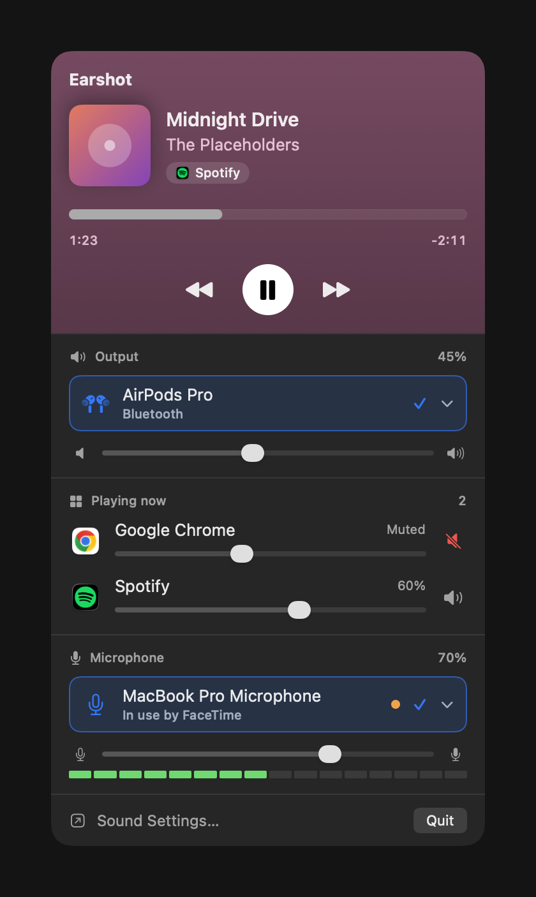

# Earshot

**Per-app volume, output and microphone control for the macOS menu bar.**

macOS only offers a single system volume: there is no way to lower one app while
keeping another loud, and some outputs (like HDMI monitors) expose no volume
control at all. Earshot fixes that from the menu bar, using Core Audio Process
Taps — no virtual audio driver, no kernel extension.

<p align="center">
  
</p>

[Download](#download) · [Build from source](#build-from-source) · [Design](docs/DESIGN.md)

## Features

### 🎵 Now playing
- The current track from any player (Spotify, Music, a YouTube tab…) with
  artwork, artist and the app that is playing it.
- A progress bar with elapsed and remaining time, and previous, play/pause and
  next buttons.
- The header takes the artwork's average color.

### 🔊 Output
- Pick the output device from cards with an icon per kind (built-in, AirPods,
  Bluetooth, USB, HDMI/DisplayPort, AirPlay); only the selected one is shown
  until you expand the list.
- Master volume and mute. Outputs without a hardware volume (HDMI monitors, for
  example) get a **software master** instead, so the slider always works.

### 🎚️ Per-app mixer
- Every app playing audio gets its own volume slider and mute button, with
  helper processes grouped under their app (a browser and its tabs).
- Volumes are remembered per app between launches.
- Taps are created only for apps you actually change, so apps at 100% are left
  untouched.

### 🎙️ Microphone
- Pick the input device, set its input volume and mute it. The menu bar icon
  shows when the mic is muted.
- See which app is using the microphone ("In use by FaceTime"), with a live
  level meter that turns on by itself while another app is capturing.

### And also
- English and Brazilian Portuguese.
- A shortcut to the system Sound settings, and ⌘Q to quit.

### Coming next
- Per-app level meters.
- Volume keys (F11/F12) for the software master and a global mic-mute shortcut.
- Launch at login and a proper app icon.

## Made with vibe coding

Earshot was built entirely through **vibe coding**: every line of code, test and
doc in this repository was written by AI agents
([Claude Code](https://claude.com/claude-code)) from a conversation in plain
language, with a human deciding what to build, testing it on real hardware and
reviewing the result. The design decisions from that conversation are recorded
in [`docs/DESIGN.md`](docs/DESIGN.md).

## Requirements

- **macOS 14.4 or later** — process taps exist since 14.2, but the
  `NSAudioCaptureUsageDescription` permission and stable behavior arrived around
  14.4.
- **Xcode 16 or later**, with the Swift 6 toolchain.

> macOS 14.x and 15.x are **best-effort** until confirmed by users. Development
> and primary testing happen on macOS 26.

## Download

Grab the latest `Earshot-<version>.zip` from
[Releases](https://github.com/gustavoscarpini/earshot/releases), unzip it and
move `Earshot.app` to `/Applications`.

> [!IMPORTANT]
> Releases are **not notarized** yet (no Developer ID), so macOS blocks the
> first launch. Open Earshot once, dismiss the warning, then go to **System
> Settings › Privacy & Security**, scroll down and click **Open Anyway**. You
> only do this once per version. Prefer not to? [Build from source](#build-from-source).
>
> Each new version has a new signature, so macOS asks again for the audio
> capture and microphone permissions after updating.

## Build from source

1. Configure your local signing settings:

   ```sh
   cp Config/Local.xcconfig.example Config/Local.xcconfig
   ```

   Then edit `Config/Local.xcconfig` and uncomment **both** `DEVELOPMENT_TEAM`
   (a free Personal Team works) and `CODE_SIGN_IDENTITY = Apple Development`.
   Setting only the team keeps ad-hoc signing. Optionally change
   `BUNDLE_ID_PREFIX` if `com.gustavoscarpini` collides with something you
   already registered.

2. Build and install:

   ```sh
   make install
   ```

   That runs a Release build and copies `Earshot.app` into `/Applications`.
   Prefer to run it from the build directory? Use `make release` and open
   `build/Build/Products/Release/Earshot.app`.

Other targets:

| Target | What it does |
| --- | --- |
| `make build` | Debug build |
| `make test` | Runs the unit tests |
| `make release` | Release build |
| `make install` | Release build, copied to `/Applications` |
| `make dist` | Release zip in `build/release` (see [Releases](#releases)) |
| `make clean` | Removes `build/` and Xcode's project caches |

You can also open `Earshot.xcodeproj` in Xcode and run the `Earshot` scheme.

### ⚠️ Signing without a team

If you leave `DEVELOPMENT_TEAM` empty, the build falls back to ad-hoc signing
("Sign to Run Locally") and Earshot still runs. **However, macOS ties permission
grants to the code signature, so it will re-ask for audio-capture permission
after every rebuild.** Setting a real `DEVELOPMENT_TEAM` gives your builds a
stable identity and avoids the repeated prompts.

## Releases

Maintainers publish a release by pushing a version tag:

```sh
git tag v0.1.0
git push origin v0.1.0
```

`.github/workflows/release.yml` then runs the tests, builds a universal app with
`Scripts/package-release.sh` and creates the GitHub release with the zip and
its SHA-256.

Without secrets the app is ad-hoc signed and not notarized. To ship Developer ID
signed, notarized builds, the team's Account Holder creates a "Developer ID
Application" certificate and these repository secrets are added:

| Secret | What it is |
| --- | --- |
| `APPLE_TEAM_ID` | The 10-character team ID |
| `DEVELOPER_ID_CERTIFICATE_P12` | The "Developer ID Application" certificate with its private key, exported as `.p12` and base64-encoded |
| `DEVELOPER_ID_CERTIFICATE_PASSWORD` | The `.p12` export password |
| `NOTARY_KEY_P8` | An App Store Connect API key (`AuthKey_XXXX.p8`), base64-encoded |
| `NOTARY_KEY_ID` | That key's ID |
| `NOTARY_ISSUER_ID` | The issuer ID shown above the keys list in App Store Connect |

To build the same zip locally:

```sh
VERSION=0.1.0 make dist    # ad-hoc, not notarized
# Developer ID: certificate in your keychain, credentials saved with
# `xcrun notarytool store-credentials earshot`
TEAM_ID=ABCDE12345 VERSION=0.1.0 NOTARY_PROFILE=earshot make dist
```

## Permissions

- **System Audio Recording** — required. Earshot captures each app's audio with
  Core Audio Process Taps in order to apply its volume
  (`NSAudioCaptureUsageDescription`).
- **Microphone** — only while the input level meter runs. Earshot never records
  or stores audio (`NSMicrophoneUsageDescription`).

Earshot is not sandboxed (`ENABLE_APP_SANDBOX = NO`) and runs with the hardened
runtime.

## Testing

```sh
make test
```

The pure core logic (gain computation, tap planning, app grouping, the now
playing stream parser and more) is covered with
[Swift Testing](https://developer.apple.com/xcode/swift-testing/). The system
layer sits behind the `AudioProcessMonitor`, `TapController`,
`AudioDeviceController`, `InputLevelMeter` and `NowPlayingSource` protocols so
it can be faked in tests.

The README screenshot is the real panel rendered with sample data. To refresh it:

```sh
EARSHOT_SCREENSHOT=1 TEST_RUNNER_EARSHOT_SCREENSHOT=1 xcodebuild test \
  -project Earshot.xcodeproj -scheme Earshot -destination 'platform=macOS' \
  -derivedDataPath build CODE_SIGNING_ALLOWED=NO \
  -only-testing:EarshotTests/ReadmeScreenshot
```

A manual checklist covering the scenarios that need real hardware lives in
[`docs/manual-test.md`](docs/manual-test.md).

## Third-party

The now playing header uses [mediaremote-adapter](https://github.com/ungive/mediaremote-adapter)
by Jonas van den Berg, vendored in `Vendor/mediaremote-adapter/` and built into
the app. It is licensed under the BSD 3-Clause License; see
[`Vendor/mediaremote-adapter/LICENSE`](Vendor/mediaremote-adapter/LICENSE).

## License

[MIT](LICENSE) © 2026 Gustavo Scarpini
